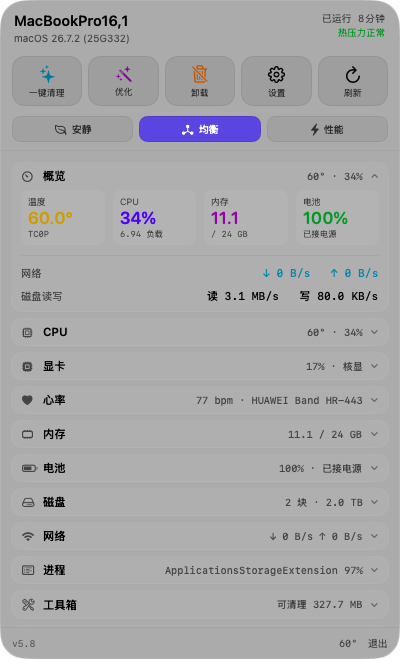
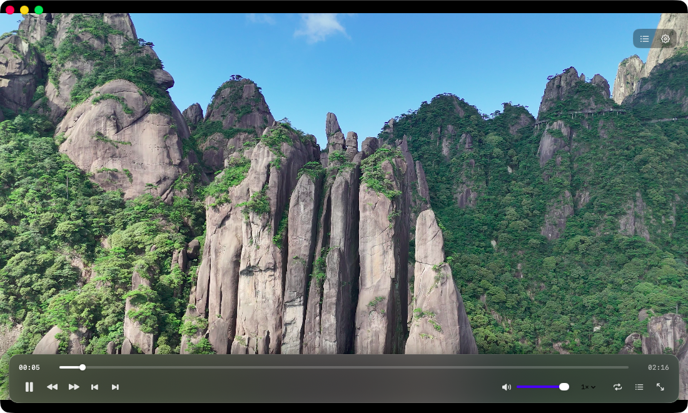

# Hackintosh Tools · macOS 26 小工具集

两个原生 macOS 菜单栏/桌面工具，用 Swift + SwiftUI（部分 C + IOKit）写成，主打**零依赖、单文件构建脚本、本地自签名即可运行**。为 macOS 26 (Tahoe) 的 Liquid Glass 设计，在 Intel Hackintosh 上实测通过（也适用于白苹果）。

| App | 版本 | 说明 | 截图 |
|---|---|---|---|
| **SensorBar** | 5.9 | 菜单栏状态监控：CPU 温度/各核温度/功耗/电压（直读 AppleSMC）、GPU 占用、内存细分、电池健康、磁盘读写、实时网速 + Cloudflare 测速、进程 TOP、工具箱（清理缓存/卸载 App/一键优化/磁盘 NTFS） |  |
| **VideoBar** | 1.3 | 视频播放器：4K60 HEVC 硬解直通（实时 ×1.000）、2× 自动切 1080p 代理保持流畅、悬浮毛玻璃控制条、播放列表、续播、全屏、独立设置窗口 |  |

## 下载 / 安装

- **Releases 页面** 提供两个独立安装包：`SensorBar-<版本>.pkg`、`VideoBar-<版本>.pkg`（各自装到 `/Applications`）
- 或自行构建（见下），产物直接 `open` 即可

> 这些包是**本地 ad-hoc 签名**，没有 Apple 开发者证书。第一次打开若提示「无法打开，因为无法验证开发者」：
> 右键 →「打开」→ 再点「打开」；或终端执行 `xattr -dr com.apple.quarantine /Applications/SensorBar.app`。

## 构建（无需 Xcode 工程，脚本直接调 swiftc/clang）

要求：macOS 26 + Xcode（命令行工具即可），Intel 或 Apple Silicon。

```bash
# SensorBar（菜单栏监控）
cd sensors && ./build.sh            # → sensors/SensorBar.app

# VideoBar（播放器）
cd videobar && ./build.sh           # → videobar/VideoBar.app

一键打 pkg（两个 App 一起）：

```bash
bash installer/make-installer.sh    # → HackintoshTools-<ver>.pkg
```

## 目录结构

```
sensors/         SensorBar：SwiftUI 界面 + bridge.c（AppleSMC / IOKit / libproc）+ smc/sensmon 命令行
videobar/        VideoBar：AVFoundation + SwiftUI
installer/       pkgbuild/productbuild 打包脚本（带安装器欢迎页/完成页）
mas/             可选：App Store 可行性分析与沙箱版构建脚本
```

## 技术要点（踩过的坑都写在各自 README 里）

- **AppleSMC 直读**：`IOServiceOpen` + `IOConnectCallStructMethod`，122 个键；`spXY` 定点类型要按十六进制拆整数/小数位（sp78、sp96、sp3c）。
- **macOS 26 亮度链路**：`corebrightnessd → AGDC → DPMicro`，黑苹果没有 DPMicro 时系统判定「内屏不可控」，滑块变灰。本项目的做法是绕开系统、直接写 IOKit 的 `bklt` 整数参数。
- **4K60 HEVC 播放**：`AVPlayerLayer` + 硬件解码（`VTIsHardwareDecodeSupported`），实测 130 Mbps 4K60 原片解码 106 fps、播放实时倍率 1.000、零掉帧。
- **Intel 蓝牙 LE 连接挂死**：macOS 26 上 `bluetoothd` 卡在 `LE_READY_WAIT_FOR_LENGTH`，需 IntelBluetoothFirmware 2.5.3（lshbluesky fork）；修复后可用标准 GATT 心率服务（0x180D/0x2A37）读华为手环心率。
- **macOS 26 Liquid Glass**：`SwiftUICore` 的 `.glassEffect(_:in:)`（macOS 26.0+），用 `Glass.regular/.clear` + `.tint()` 控制通透度。

## 已知限制

- SensorBar 的传感器数据来自 SMC，不同机型键名不同（本项目在 i7-9750H + UHD 630 上验证）；风扇转速依赖 SMCSuperIO，部分机型 SMC 不暴露（本机 `FNum=0`）。
- 本项目**不上 App Store**（Sandbox 会禁掉 AppleSMC / libproc / 子进程等能力），分析与可选沙箱版见 `mas/README.md`。

## License

MIT，见 [LICENSE](LICENSE)。
