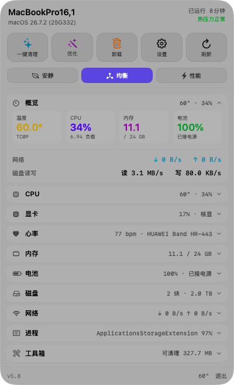
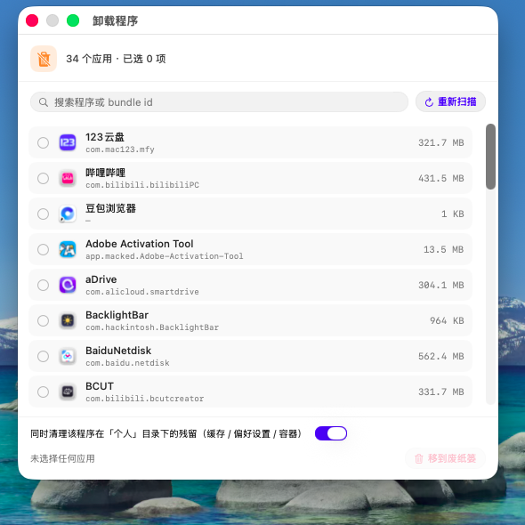
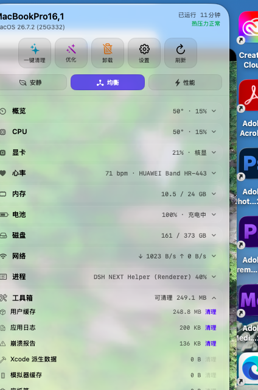
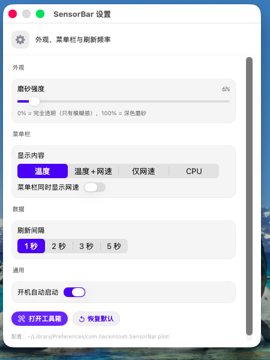

# 黑苹果传感器监控（smc + sensmon）

纯 C + IOKit 直接从 `AppleSMC` 读键值（本机由 VirtualSMC / SMCProcessor / SMCBatteryManager 提供），不需要 root、不需要任何第三方库或后台守护进程。

## 文件

| 文件 | 说明 |
|---|---|
| `smc_lib.h` | AppleSMC 读取与类型解码（`sp78`/`sp96`/`sp3c`/`fpe2`/`flt`/`ui*`/`si*` 等）的公共实现 |
| `smc.c` → `smc` | 命令行：枚举全部键 / 读单个键 / 持续刷新 |
| `sensmon.c` → `sensmon` | 监控界面：每秒刷新一行行数值，或输出 JSON |
| `smc-dump.txt` | 本机全部 122 个 SMC 键的一次快照 |
| `sample-output.txt` | `sensmon --once` 的实际输出样例 |

## 编译

```bash
cd sensors
clang -O2 -o smc smc.c -framework IOKit -framework CoreFoundation
clang -O2 -o sensmon sensmon.c -framework IOKit -framework CoreFoundation
```

## 用法

```bash
./smc list            # 全部 SMC 键（KEY / TYPE / 解码后的值）
./smc get TC0P        # 读单个键
./smc watch 30        # 每 1 秒刷新全部数值型键，共 30 次

./sensmon             # 实时监控界面（Ctrl-C 退出）
./sensmon --once      # 打印一屏后退出（适合截图/日志）
./sensmon --json      # 单次 JSON 输出（适合喂给别的程序/脚本）
./sensmon -n 10 -i 500   # 采 10 次，间隔 500 ms
```

`--json` 字段：`cpu_usage / load / temp_pkg / temp_max_core / cores[] / power_cpu / power_pl / vcore / thermal_level / battery{volt,current_ma,remain_mah,full_mah,pct,ac,charging} / fans / fan_rpm[] / memory_gb{total,used} / smc_keys`。

## 本机实际能测到的传感器（2026-11-07 实测）

| 类别 | SMC 键 | 类型 | 含义 | 实测 |
|---|---|---|---|---|
| CPU 封装温度 | `TC0P`（另有 `TC0D/TC0E/TC0F/TC0H/TC0p` 同值） | sp78 | 靠近 CPU 的传感器 | 48–54 °C |
| 每核温度 | `TC1C` … `TC6C`（`TC0C` 本机不存在） | sp78 | i7-9750H 6 个物理核 | 47–53 °C |
| CPU 功耗 | `PC0R` | sp96 | 整包功耗 | 7–22 W |
| 功耗上限 | `PCPT` / `PCTR` / `PCPR` | sp96 | PL 上限（同值） | 19–34 W |
| CPU 电压 | `VC0C` | sp3c | 核心电压 | 0.75–1.02 V |
| 电池电压 | `B0AV` | ui16 | mV | 12709 mV |
| 电池电流 | `B0AC` | si16 | mA（正=充电） | 0 mA（满电） |
| 电池容量 | `B0RM` / `B0FC` | ui16 | 剩余 / 满容量 mAh | 3823 / 3861 mAh（健康 99%） |
| 电量百分比 | `BFCL` | ui8 | % | 100 |
| 外接电源 | `ACIN` | flag | 是否插电 | 是 |
| 风扇 | `FNum` = 0、`FAC0` = 0 | ui8 | **本机没有暴露任何风扇键** | — |

系统级指标（不走 SMC）：CPU 使用率与负载（`host_statistics` / `getloadavg`）、内存与交换（`vm_statistics64` / `vm.swapusage`）、热压力等级（`sysctl machdep.xcpm.cpu_thermal_level`）。

## 这台机器上测不到什么，为什么

- **风扇转速**：`FNum = 0`，SMC 里没有 `F0Ac` 一类键。VirtualSMC 的 SMCSuperIO 在这台联想上没有识别出 EC 风扇通道，所以没有数据可读（不是程序的问题）。
- **NVIDIA GTX 1050 温度/功耗**：macOS 26 没有 NVIDIA 驱动，GPU 处于不可用状态，没有任何 SMC 键或 IOKit 接口能读它。
- **Intel UHD 630 温度**：Apple 的 iGPU 驱动不暴露温度，SMC 里也没有对应键。
- **SSD 温度**：本机是 KIOXIA EXCERIA G2，`ioreg` 显示 `NVMe SMART Capable = Yes`，但 macOS 没有用户态读取 NVMe SMART 温度日志的公开接口（除非装 `smartmontools` 并以 root 读，代价大、收益小）。
- **其他**：没有环境光、没有 T2、没有 SMC 键盘背光/屏幕亮度以外的高级传感器。

## 与亮度的关系

亮度不在这里：macOS 26 的系统亮度栈（corebrightnessd → AGDC → DPMicro）在本机不可用，SensorBar 只负责「看」指标，不改任何值。

---

## 四、SensorBar：菜单栏常驻监控（macOS 26 Liquid Glass，v3 折叠 + 工具箱 + 设置）

`sensors/SensorBar.app` 是把传感器数据做成常驻菜单栏的小 App：点菜单栏的 `53°` 弹出玻璃面板，数据每秒刷新。

v3 相对 v1 的变化：**折叠式分区**（只展开想看的，默认只开「概览」）、**更通透的玻璃**（tint 0.18 → 0.04，可 0）、**面板高度随内容自动调整**、**工具箱（清理缓存/日志/派生数据/废纸篓）**、**独立设置窗口**，并补齐 Sensei 那类监控项（内存明细、电池健康、磁盘 IO、进程排行、SMC 全量浏览、Wi-Fi 信息）。

### 折叠分区

| 分区 | 折叠时右侧摘要 | 展开后内容 |
| --- | --- | --- |
| 概览 | `53° · 16%` | 四个小方块（温度 / CPU / 内存 / 电池）+ 网络速率 + 磁盘读写 |
| CPU | `53° · 16%` | 封装温度大字、6 核柱状温度、使用率、负载 1/5/15、功耗（上限）、电压、占用最高的 4 个进程 |
| 内存 | `12.0 / 24 GB` | 已用进度条、已用 / 活跃/联动 / 压缩 / 交换 / 内存压力 + 占用内存最多的 4 个进程 |
| 电池 | `100% · 已接电源` | 电量条、状态、电压/电流、剩余/满容量、设计容量、循环次数、健康度、剩余时间、外接电源 |
| 磁盘 | `154 / 373 GB` | 可用/总量条、读/写速率、本次开机累计读写、SSD 型号 |
| 网络 | `↓ 0 B/s ↑ 0 B/s` | 实时速率 + 折线、累计流量、接口/IP、Wi-Fi SSID/信道/信号/协商速率、Cloudflare 测速按钮 |
| 进程 | 占用最高者 | CPU 占用前 5 + 内存占用前 5（CPU% 是单核百分比，多线程可超 100%） |
| 工具箱 | `可清理 6.8 GB` | ① 清理：用户缓存 / 应用日志 / 崩溃报告 / Xcode 派生数据 / 模拟器缓存 / 废纸篓 / 系统缓存（需 sudo）；② 工具：卸载程序（含残留清理）、一键优化、SSD TRIM；③ 维护：清空剪贴板、重启 Dock、重启 Finder、刷新 DNS |
| 系统 | `MacBookPro16,1` | 型号、序列号（脱敏）、Board ID、处理器、核心、显卡、显示器、内存、磁盘、SMC/风扇、系统版本、开机时长 |
| 底部 | — | 「设置」「工具箱」「退出」+ 菜单栏温度 |

头部固定显示 SMBIOS 型号 + `macOS 26.7.2 (25G332)` + 已运行时长 + 热压力状态。

折叠动效：`withAnimation(.easeInOut(duration: 0.16))` + `.transition(.opacity.combined(with: .move(edge: .top)))`，标题行右侧的 chevron 会旋转 180°。

### 设置窗口

点面板底部「设置」打开独立窗口（`SettingsView.swift`），配置即时生效并写入 `~/Library/Preferences/com.hackintosh.SensorBar.plist`：

| 项目 | 取值 | 说明 |
| --- | --- | --- |
| 磨砂强度 | 0–100% | 对应 `glassOpacity` 0–0.25；0% = 纯模糊最透，100% = 深色磨砂 |
| 菜单栏显示 | 温度 / 温度+网速 / 仅网速 / CPU | 菜单栏标题跟着变 |
| 刷新间隔 | 1 / 2 / 3 / 5 秒 | 数据采集与菜单栏刷新的周期 |
| 开机自动启动 | 开 / 关 | 写 `~/Library/LaunchAgents/com.hackintosh.SensorBar.plist`，记录当前可执行文件路径 |
| 菜单栏同时显示网速 | 开 / 关 | 兼容旧开关（「温度」模式下生效） |

「恢复默认」把上面几项重置；「打开工具箱」直接展开面板里的工具箱分区。

### 工具箱（清理）

`Tools.swift` 里的 `Toolbox` 负责统计与清理，路径固定为：

| 项目 | 路径 | 说明 |
| --- | --- | --- |
| 用户缓存 | `~/Library/Caches` | 最大头，常见几个 GB |
| 应用日志 | `~/Library/Logs` | |
| 崩溃报告 | `~/Library/Logs/DiagnosticReports` | |
| Xcode 派生数据 | `~/Library/Developer/Xcode/DerivedData` | 没装 Xcode 时不存在 |
| 模拟器缓存 | `~/Library/Developer/CoreSimulator/Caches` | |
| 废纸篓 | `~/.Trash` | 等同「清倒废纸篓」 |
| 系统缓存 | `/Library/Caches` | 需要管理员，只显示大小并提供 sudo 命令提示 |

清理只删除目录里的内容、保留目录本身；删除失败（文件被占用）会计数提示；每个目录单独清理前会弹确认框，显示将释放多少空间。体积统计在后台线程做（大目录首次扫描要几秒），清理完自动重扫。

### 卸载程序 / 一键优化 / SSD TRIM

工具箱里三枚按钮：

**卸载程序…**（`UninstallerView.swift`）
- 列出 `/Applications` 下的所有 App，每行带**真实应用图标**（`NSWorkspace.shared.icon(forFile:)`，32pt 源图渲染成 20pt）+ 名字 + bundle id；
- 先出名字/图标、体积在后台逐个补（Adobe 这类几个 GB 的程序不会卡界面，37 个 App 全部算完约 15–20 秒）；
- 支持搜索、多选；勾选「同时清理残留」会一并处理 `~/Library` 下的 `Application Support/<bundleID>`、`Caches`、`Preferences/<bundleID>.plist`、`Logs`、`Containers`、`Saved Application State`、`HTTPStorages`、`WebKit` 以及同名 Application Support 目录；
- 全部走 `FileManager.trashItem`（移到废纸篓，可恢复），不会直接 rm；完成后提示释放了多少空间；
- 卸载前会检查程序是否正在运行：运行中的直接跳过并在结果里点名（「已跳过正在运行的 X」），避免卸到一半报权限错误；
- 失败会给出具体原因（`appFail` / `leftoverFail` 分开统计，附带 `localizedDescription`）。

**关于「you don't have permission to access it」**
macOS 13 起系统增加了「App 管理」（App Management）隐私权限：一个 App 想移动/删除 `/Applications` 里的其它 App，必须先被用户在
`系统设置 → 隐私与安全性 → App 管理` 里勾选，否则 `FileManager.trashItem` 会直接报上面那句权限错误（本地 ad-hoc 签名 + 没有开发者 ID 时尤其容易静默失败）。

处理策略（v4.3）：
1. 先用普通权限 `trashItem`（已授权的情况下没有任何弹窗）；
2. 若报权限错误，自动降级为管理员权限移动：`/usr/bin/osascript -e 'on run argv' -e 'do shell script (item 1 of argv) with administrator privileges' -e 'end run' -- <脚本>`——脚本通过 **argv** 传给 osascript，避免三层引号嵌套；一次密码搞定同批多个 App，全部移到 `~/.Trash`（仍可恢复）；
3. 两种方式都失败时，错误信息里会提示去「App 管理」授权。

**一键优化**
依次执行（都是用户级、不需要密码）：
1. 重建 LaunchServices 数据库（`lsregister -kill -r -domain local -domain system -domain user`）——修「打开方式」菜单混乱、图标不刷新；
2. 清理 QuickLook 缩略图缓存（`qlmanage -r cache`）；
3. 刷新 DNS 缓存（`dscacheutil -flushcache`）；
4. 重启 Dock、重启 Finder；
5. 清空废纸篓并统计释放量。

**SSD TRIM**
点开先读 `system_profiler SPNVMeDataType` / `SPSerialATADataType` 报告状态，本机实测：

```
磁盘：KIOXIA-EXCERIA G2 SSD
TRIM：Yes（NVMe 由系统自动下发 TRIM，无需手动处理）
```

NVMe 盘在 macOS 下 TRIM 是自动的，状态为 Yes 就不需要额外操作；如果是 SATA SSD 显示 `No`，弹窗里的「开启/修复 TRIM」会用 `osascript ... with administrator privileges` 调 `trimforce enable`（要输管理员密码，重启后生效）。

### 电池剩余时间

旧版本直接用 IORegistry 的 `TimeRemaining`/容量比，插着电源时也算出一个荒谬的时间（比如「507 小时」）。现在的规则：

- **接着电源**：显示「接通电源，不耗电池」或「充电中（接通电源）」，不再显示剩余时间；
- **电池供电**：`剩余容量 ÷ 放电电流 × 60` 计算分钟数，超过 24 小时或电流过小则显示「计算中」。

### 磨砂玻璃

```swift
.glassEffect(.regular.tint(Color.black.opacity(glassOpacity)), in: .rect(cornerRadius: 26))
```

`glassOpacity` 是 `@AppStorage`，默认 `0.04`，随设置窗口的滑块实时变化。

- `glassEffect` 是 macOS 26 新 API，低于 26 会编译失败，所以 `build.sh` 里必须 `-target x86_64-apple-macos26.0`。
- tint 越小越通透：`0.04` 是当前默认；`0.0` 最透（浅色壁纸上文字会略糊），`0.18` 是 v1 的保守值。为了在低 tint 下保持可读性，面板里的次级文字用的是 `Color.primary.opacity(0.72)` 而不是系统 `.secondary`。
- 面板是 `NSPanel(styleMask: [.borderless, .nonactivatingPanel], level: .statusBar)` + `NSHostingView`：不抢焦点、浮在 Dock 之上、点面板外自动收起。

### 动态高度

`ScrollView` 里的内容用 `GeometryReader` + `ContentHeightKey`（`PreferenceKey`）上报真实高度，通过通知告诉 `AppDelegate`，再 `panel.setContentSize(min(820, max(320, content + 100)))` —— 所以折叠少的时候面板短、展开多的时候面板长，超过 820 就在内部滚动。

### 构建 / 运行

```bash
cd sensors
./build.sh                    # 编译 smc / sensmon / SensorBar.app
open SensorBar.app            # 运行（菜单栏出现温度）
cp -R SensorBar.app /Applications/   # 长期使用
```

调试用参数：`--show` 启动即弹面板；`--open=cpu,mem,net,tools` 指定启动时展开哪些分区；`--settings` 打开设置窗口；`--uninstall` 打开卸载程序窗口；`--trim` 只打印 TRIM 状态；`--speedtest` 只跑一次测速。

源码拆成 `SensorBar.swift`（面板与 AppDelegate）、`SettingsView.swift`（设置窗口）、`Tools.swift`（清理/卸载/优化/TRIM）、`UninstallerView.swift`（卸载程序窗口）、`main.swift`（入口，多文件编译时顶层代码必须放这里）。`build.sh` 关键点：`-target x86_64-apple-macos26.0`；`-module-cache-path` 指到可写目录（默认沙箱/只读目录会失败）；App 在 `.build` 里组装并 `codesign -f -s - --force`（工作区是 file-provider 卷，原地签名会报 resource fork 错误），最后 `ditto` 回来；Swift 侧要链 `-framework CoreWLAN`（Wi-Fi 信息）。

### 已知限制

- **没有风扇转速**：`FNum = 0`，本机 SMC/SMCSuperIO 没暴露风扇键。
- **没有 GPU 温度**：macOS 26 无 NVIDIA 驱动；Intel iGPU 也不暴露温度；SSD（KIOXIA）虽支持 SMART 但 macOS 无用户态读温接口。
- **Wi-Fi SSID 可能为空**：macOS 26 把 SSID 归到「定位服务」，没授权时 `CWWiFiClient` 返回 nil（此时该两行自动隐藏）。
- CPU% 是**单核百分比**（和 Activity Monitor 一致），多线程进程会 >100%。
- 测速走 Cloudflare 单连接 HTTP，数值低于 iperf；只用于看趋势。
- 头部型号是 SMBIOS 伪装值（`MacBookPro16,1`），不是联想原型号。

### 截图

折叠态（默认，SMC 分区已按要求移除；顶部是控制中心风格快捷磁贴）：



卸载程序窗口：



展开工具箱：



设置窗口：



多分区展开（概览/CPU/内存/电池/磁盘）：


## v5.0 新增：GPU 占用 / 性能模式 / 外设电量 / 磁盘-NTFS 工具

### 1. 显卡分区（GPU 占用）
- 数据来源：`IntelAccelerator` 的 `PerformanceStatistics` 字典里的 `Device Utilization %`（以及 `Device Utilization % at cur p-state`），C 侧实现 `sbi_gpu_util()` / `sbi_gpu_util_at_pstate()`（`bridge.c` 的 `gpu_stat_int()`，动态 key 必须用 `CFStringCreateWithCString`，不能用 `CFSTR(key)`）。
- 面板里是独立的「显卡」折叠区：大字占用百分比 + 进度条 + 当前 P-State 占用 + 设备名 + 显存；摘要行显示「35% · 核显」。
- NVIDIA GTX 1050 在 macOS 26 没有驱动，不产生任何指标（面板里已注明）。

### 2. 性能模式（CPU 功耗策略）
快捷工具图标正下方常驻三枚按钮（`powerModeRow`，不在滚动区里，任何时候都能点），按下会弹一次管理员授权（`osascript ... with administrator privileges`），执行：

| 模式 | 实际动作 | 效果 |
|---|---|---|
| 安静 | `pmset -a lowpowermode 1 && pmset -a powernap 0` | 打开低电量模式，抑制睿频，机器最安静 |
| 均衡 | `pmset -a lowpowermode 0 && pmset -a powernap 1` | 系统默认调度 |
| 性能 | `pmset -a lowpowermode 0 && pmset -a powernap 0 && sysctl -w debug.lowpri_throttle_enabled=0` | 关掉低电量模式 + 后台 I/O 节流 |

同时写 `~/Library/Preferences/.GlobalPreferences.plist` 的 `NSAppSleepDisabled`（性能模式 = YES，其余 = NO，用来关/开 App Nap）。
当前模式由 `PowerMode.refresh()` 读 `pmset -g` + `defaults read` 反推，选中项用青/蓝/橙高亮。

> 说明：Intel Mac / 黑苹果上 macOS 没有开放 PL1/PL2（MSR 0x610）的写入接口，能做到的最接近「功耗墙」的手段就是低电量模式（EPP 偏向能效、抑制睿频）+ 后台节流开关；想要真正的功耗点数限制需要改 BIOS/写 MSR 驱动。

### 3. 磁盘 / NTFS 工具
面板「工具箱 → 工具 → 磁盘 / NTFS」打开独立窗口（`DiskToolsView.swift`，560×460）：
- 列出 `/Volumes` 下所有卷：名称、设备节点、文件系统类型（`statfs` 的 `f_fstypename`）、可用/总量；
- NTFS 卷额外显示「挂载为可读写 / 挂载为只读」（由 `statfs` 的 `MNT_RDONLY` 标志判断，不受进程沙箱影响）；
- 每卷提供「打开 / 卸载 / 测写入」；NTFS 卷多一个「重新挂载(读写)」（`diskutil unmount force` + `diskutil mount`，需要管理员密码）；
- 底部说明本机检测到的驱动情况与没有第三方驱动时的安装命令。

**本机现状（实测）**：已安装 Tuxera NTFS，4 个 NTFS 卷（`/Volumes/F`、`/Volumes/Win11 Pro X64`、`/Volumes/D`、`/Volumes/Software`）挂载类型都是 `tuxera_ntfs`，也就是**已经能读写**，不需要再装任何东西。macOS 自带 NTFS 驱动只能读，所以「不能写」只会在没装 Tuxera/Paragon 的情况下出现；那时可装 `macFUSE + ntfs-3g`（`brew install --cask macfuse && brew install gromgit/fuse/ntfs-3g-mac`），本机目前没有 Homebrew。

## v5.2：界面统一美化 + 主面板全透明

### 外设分区已移除
按需求删掉了「外设」折叠区（`periphSection`、`Metrics.peripherals`、`readPeripherals()` 全部清理），`bridge.c` 里的 `sbi_wireless_battery()` 仍保留（命令行/以后要用可直接调）。

### 主面板全透明
`RootView` 的玻璃从 `.regular.tint(...)` 改为按设置判断：
- `glassOpacity == 0`（默认）→ `.glassEffect(.clear, ...)`，几乎只剩模糊与极细描边，桌面/壁纸直接透出来；
- 拖动设置里的「磨砂强度」> 0 才切回 `.regular.tint(black, alpha)` 的深色磨砂。

### 三个工具窗口统一重做
新增 `sensors/WindowStyle.swift`，提供一套共用组件：
- `GlassBackground`：`NSVisualEffectView(material: .underWindowBackground, blendingMode: .behindWindow)`；
- `WindowShell`：玻璃底 + 顶部图标标题栏（彩色圆角图标 + 标题 + 副标题）+ 分隔线 + 内容区；
- `WCard`：圆角卡片容器（`Color.primary.opacity(0.045)` + 0.08 描边）；
- `WSectionTitle` / `WRow` / `PillButton`：小标题、行、胶囊按钮（filled / 描边两种）。
窗口本身用 `styleWindow(_:)` 统一配置：`titlebarAppearsTransparent = true`、`titleVisibility = .hidden`、`fullSizeContentView`、`isMovableByWindowBackground = true`、`backgroundColor = .clear`、`isOpaque = false`。

- **设置**（430×540）：外观 / 菜单栏 / 数据 / 通用 四张卡片，分段控件与开关统一 `.controlSize(.mini)`，底部「打开工具箱」「恢复默认」胶囊按钮 + 保存提示；
- **卸载程序**（540×500）：顶部搜索胶囊 + 重新扫描，应用行带图标/bundle id/体积与选中高亮，底部残留开关与红色「移到废纸篓」；
- **磁盘 / NTFS**（560×480）：卷卡片（图标、文件系统标签、读写状态、容量、操作胶囊按钮）+ 底部 NTFS 说明。

## v5.3：标题栏恢复系统白、面板主体提亮

- 三个工具窗口不再透明化：`styleWindow()` 改回 `titlebarAppearsTransparent = false`、`titleVisibility = .visible`、去掉 `.fullSizeContentView`、`backgroundColor = .windowBackgroundColor`、`isOpaque = true`——标题栏是系统标准白色条（带红黄绿按钮），窗口正文就是普通浅色底。
- `WindowShell` 顶部不再重复标题（标题在标题栏里），只保留彩色图标 + 副标题（如「外观、菜单栏与刷新频率」「34 个应用 · 已选 0 项」「卷列表 · 读写状态 · 卸载与重新挂载」）。
- 主面板提亮：`.glassEffect(.clear.tint(Color.white.opacity(0.16)), in: ...)`，比之前的纯 `.clear` 亮一档，浅色壁纸/白窗口上正文更清楚；磨砂强度 >0 时仍然切回深色 `.regular` 磨砂。

## v5.4：从华为手环读取实时心率（标准 BLE）

### 为什么这样做
华为运动健康没有 macOS 版，也没有公开的第三方 API（Health Kit 只对 HarmonyOS/Android 合作方开放）；华为自己的「情绪」数据是云端私有算法，拿不到。但**华为手环/手表本身在广播标准蓝牙心率服务**，所以走 GATT 直读是唯一靠谱的路子——不需要装任何华为软件、不需要登录账号。

### 前置条件（已在本机完成）
- Intel 蓝牙在 macOS 26 上 LE 连不上（`bluetoothd` 卡在 `LE_READY_WAIT_FOR_LENGTH`）→ 换成 lshbluesky 的 **IntelBluetoothFirmware 2.5.3**（`IntelBluetoothFirmware.kext` + `IntelBTPatcher.kext`，不要装 Injector），重启后 `bt-le.log` 里有 `Outgoing LE Connection complete ... status 0`，建链正常；
- 手环需开启「连续心率测量」，并且**不要被手机同时连着**（BLE 心率服务通常只允许一个连接）。

### 实现
- 新文件 `sensors/HeartRate.swift`：`HeartRateMonitor`（CoreBluetooth central）→ 扫 `CBUUID("180D")` → 连接 → 发现特征 `2A37` → `setNotifyValue(true)` → 按 flags 位 0x01 解析 16 位/8 位心率 → `@Published bpm/history/status/deviceName/lastUpdate`；断开后 3 秒自动重连。
- `Info.plist` 增加 `NSBluetoothAlwaysUsageDescription` / `NSBluetoothPeripheralUsageDescription`（否则 TCC 直接拒绝，不弹窗）。
- 面板新增「心率」折叠区（显卡下面）：大号粉色 bpm + 设备名 + 最近 60 次的心率曲线 + 最低/平均/最高 + 连接状态 + 最近更新时间。
- 菜单栏新增第 5 种显示模式「心率」：设置 → 显示内容 → 心率，菜单栏就变成 `❤️ 62`（没连上时显示 `❤️ —`）。

### 实测
华为手环 Band 11 Pro（BLE 名 `HUAWEI Band HR-443`）：连接耗时 ~4 秒，心率 54–68 bpm 连续刷新；面板与菜单栏同步更新。截图见 `SensorBar-heart.png`。

## 从安卓 Gadgetbridge 导入健康数据（步数 / 睡眠 / 心率历史）

手环的步数、睡眠、血氧、压力都在华为私有加密通道里，Mac 端蓝牙只能拿到心率/电量/佩戴位置（标准 GATT）。要拿到历史数据，走 **安卓 + Gadgetbridge**。

### 0. 华为机型支持情况（2026-11 查证）
- Gadgetbridge 官方设备页已收录 **Huawei Band 11 / Band 11 Pro**；Band 11 Pro（型号 `CDY-B49`）是 2026-04 依据 issue #5989 的反馈加入的，协议和 Band 11 基本一致（多内置 GPS），官方标注「依反馈添加、未深度测试」。
- 能力：步数 / 睡眠 / 心率 / SpO₂ / 压力同步，但官方注明「并非所有设备都支持」；TruSleep 分期只有 HarmonyOS 5+ 机型支持，旧机型只有起止时间。
- 设备页：https://gadgetbridge.org/gadgets/wearables/huawei-honor/

### 1. 安装
- F-Droid：https://f-droid.org/packages/nodomain.freeyourgadget.gadgetbridge/
- 官方 APK 在 **Codeberg Releases**（不是 GitHub，GitHub 镜像没有 release）：https://codeberg.org/Freeyourgadget/Gadgetbridge/releases

### 2. 配对（关键：可能要做华为账号鉴权）
- 若手环之前被**华为运动健康**连过，Gadgetbridge 可能报 `Authentication key negotiation failed`。解决：在 Gadgetbridge 里输入 **17 位华为账号 ID**（登录 cloud.huawei.com 后 cookie 里的 `userId`；或 `adb logcat | grep huid=`），或者把表恢复出厂设置。
- 先把华为运动健康的后台/自动重连关掉，避免抢 BLE 连接。
- 重连时用「+」重新配对；**不要点「删除设备」**（Gadgetbridge 里删设备会连带删掉它的数据）。

### 3. 导出
- Gadgetbridge 侧栏 → **数据管理 → Export zip**；也可以开「设置 → Automations」自动导出。
- 手机上的路径：`/storage/emulated/0/Android/data/nodomain.freeyourgadget.gadgetbridge/files/`
- **zip 里那个数据库文件没有扩展名，名字就叫 `Gadgetbridge`**（SQLite），另外还有 GPX 和偏好 XML。直接把整个 zip 传到 Mac 即可，`gbimport.py` 会自动从 zip 里解出来。

### 4. Mac 端解析（已备好，直接吃 zip）
`sensors/gb/gbimport.py`（只读，不改原文件）：

```bash
cd sensors/gb
python3 gbimport.py list Gadgetbridge.zip          # 列所有表 / 字段 / 行数
python3 gbimport.py dump Gadgetbridge.zip          # 健康数据表样例
python3 gbimport.py days Gadgetbridge.zip 7        # 最近 7 天 心率/睡眠/步数
python3 gbimport.py json Gadgetbridge.zip gb-health.json
```

华为数据的表结构（已内置解析）：
- `HUAWEI_ACTIVITY_SAMPLE`：`TIMESTAMP, DEVICE_ID, USER_ID, OTHER_TIMESTAMP, SOURCE, RAW_KIND, RAW_INTENSITY, STEPS, CALORIES, DISTANCE, SPO, HEART_RATE`
- 睡眠是**区间标记**：`RAW_KIND` 0x06=浅睡、0x07=深睡；`SOURCE` 0x0a=TruSleep、0x0d=活动睡眠。脚本会把相邻样本（间隔 <15 分钟）合并成睡眠段并统计时长。
- 还有 `HUAWEI_WORKOUT_SUMMARY_SAMPLE` / `HUAWEI_WORKOUT_DATA_SAMPLE` / `DEVICE` / `BASE_ACTIVITY_SUMMARY`；`MI_BAND_ACTIVITY_SAMPLE` 只用于小米设备（也做了兼容）。

### 5. 下一步
拿到真实 zip 后接进 SensorBar：面板加「历史」折叠区（最近 7/30 天步数柱状、睡眠时长、血氧/心率趋势），直接读 `gb-health.json`，无需任何系统权限。

## v5.6：移除工具箱的 TRIM 入口

按要求把 SensorBar 工具箱里的 SSD TRIM 磁贴和「工具 → SSD TRIM」按钮删掉了（连同 `showTrim`/`trimText` 状态和弹窗）。`Toolbox.trimStatus()` / `enableTRIM()` 仍保留在 `Tools.swift` 里供命令行使用（`SensorBar.app/Contents/MacOS/SensorBar --trim` 可以查 TRIM 状态），只是界面上不再出现。

## v5.7：显示全部物理磁盘（两块 1TB）

之前「磁盘」区只显示系统卷的可用/总量，看起来像只有一块盘。现在改成：

- 读取 `/usr/sbin/diskutil list -plist`（每 20 秒刷新一次，跳过合成的 APFS 容器），对每块物理盘再读 `diskutil info -plist` 拿型号/是否内置/是否 SSD/总线；
- 「磁盘」折叠区列出每块盘：型号 + 容量 + 分区清单（卷名与大小，`315M/17M/215G` 这种自适应单位）；
- 折叠行摘要改成「2 块 · 2.0 TB」，系统区「磁盘」一行也显示块数与总容量；
- 「磁盘 / NTFS」窗口顶部增加两块物理磁盘的小卡片（型号 + 容量 + 分区数）。

本机实测：`KIOXIA-EXCERIA G2 SSD 1000 GB`（7 个分区：NO NAME / Microsoft Reserved / Win11 Pro X64 / D / NO NAME / Linux Filesystem / Software）+ `Seagate ZA1024CV10002 1024 GB`（3 个分区：Apple_APFS / F / EFI）。

## v5.9：移除蓝牙心率

按要求把华为手环心率整块删掉（不是编译开关，是删代码）：

- 删除 `HeartRate.swift`；`SensorBar.swift` 里的 `hr`、`heartSection`、菜单栏「❤️ 心率」模式、`refreshStatusTitle` 的 case 4 全部移除
- `build.sh` 去掉 `-framework CoreBluetooth`；`Info.plist` 去掉 `NSBluetoothAlwaysUsageDescription` / `NSBluetoothPeripheralUsageDescription`
- 现在 SensorBar 完全不需要蓝牙权限，商店版（`build-mas.sh`）也就不存在心率相关的审核问题
